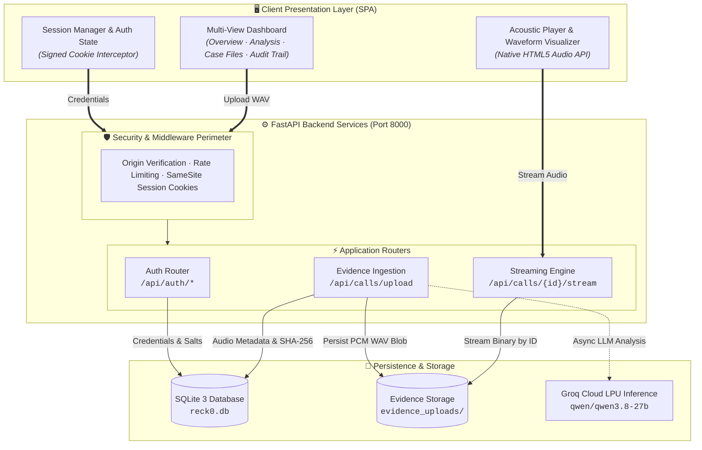

# RECK-0 — Call Intelligence & Audio Evidence Console

[](https://www.python.org/)
[](https://fastapi.tiangolo.com/)
[](https://sqlite.org/)
[]()
[]()

> **Evidence-first call triage console.** RECK-0 pairs audio integrity verification, cryptographic hashing, and timestamped forensic review to assist human investigators without guesswork.

---

## 📌 Executive Summary

**RECK-0** is an investigator-first intelligence workspace engineered for triage, acoustic playback, and digital evidence custody. Designed around an ethical "human-in-the-loop" paradigm, the console combines a low-latency web workspace, verified cryptographic storage, and interactive forensic inspection tools.

- **Cryptographic Evidence Chain:** Ingested audio files are parsed, validated for PCM integrity, and stored with immediate SHA-256 digest computation.
- **Audited Stream Architecture:** High-fidelity in-browser streaming directly from authenticated storage endpoints.
- **Enterprise-Grade Authentication:** Salted PBKDF2-HMAC-SHA256 password hashing, SameSite session isolation, and brute-force throttling.
- **Interactive Forensic UI:** Multi-view console with live acoustic waveform rendering, synchronized transcript cues, triage queueing, and CSV audit exports.

---

## 🏗 System Architecture

The RECK-0 platform employs a modular, defense-in-depth architecture designed for zero data corruption, authenticated streaming, and cryptographic accountability.

```
+---------------------------------------------------------------------------------------------------+
|                            🖥️  CLIENT PRESENTATION LAYER (Web SPA)                                |
|                                                                                                   |
|  +-------------------------------------+  +----------------------------------+  +--------------+  |
|  |       Multi-View Dashboard          |  |     Acoustic Waveform Player     |  | Session Auth |  |
|  | (Overview · Analysis · Case Files)  |  |   (HTML5 Audio · Range Stream)   |  | (Signed HTTP)|  |
|  +-------------------------------------+  +----------------------------------+  +--------------+  |
+---------------------------------------------------|---------------------------------------|-------+
                                                    | 1. Stream Request                     | 2. Ingest
                                                    v                                       v
+---------------------------------------------------------------------------------------------------+
|                        ⚙️  FASTAPI APPLICATION SERVER (:8000)                                     |
|                                                                                                   |
|  [🛡️ Security Perimeter]: Origin Check · Rate Limiter · Lax/HttpOnly Cookie · Security Headers   |
|                                                                                                   |
|   +--------------------------+  +-------------------------------+  +---------------------------+  |
|   |       Auth Router        |  |   Evidence Ingestion Router   |  |   Audio Streaming Engine  |  |
|   |     /api/auth/*          |  |       /api/calls/upload       |  |   /api/calls/{id}/stream  |  |
|   |  (PBKDF2-HMAC-SHA256)    |  |  (Size, Format & PCM Check)   |  |   (Chunked FileResponse)  |  |
|   +------------+-------------+  +---------------+---------------+  +-------------+-------------+  |
+----------------|--------------------------------|--------------------------------|----------------+
                 |                                |                                |
                 | User Credentials               | Compute Digest                 | Read by Hash
                 v                                v (SHA-256)                      v
+------------------------------------+   +----------------------------+   +-------------------------+
|     💾 SQLite Database             |   | 🔬 Cryptographic Hasher    |   | 📁 Evidence Storage     |
|         (reck0.db)                 |<--+   (Hash & Metadata Writer) +-->|   (evidence_uploads/)   |
| (Users · Evidence Registry · Logs) |   +----------------------------+   | (Raw WAV Binary Blobs)  |
+------------------------------------+                                    +-------------------------+
                                                                                       :
                                                                                       v (Optional)
                                                                          +-------------------------+
                                                                          | ⚡ Groq Cloud LPU       |
                                                                          |   (qwen/qwen3.8-27b)    |
                                                                          +-------------------------+
```

<details>
<summary><b>Click to expand Mermaid Flowchart specification</b></summary>



</details>

### Architectural Highlights & Guarantees

1. **Isolation of Audio Streams**: Audio is never bundled as base64 in JSON. It is streamed over standard HTTP byte responses directly through authenticated `/api/calls/{id}/stream` handles with MIME validation (`audio/wav`).
2. **Deterministic Cryptographic Seal**: On upload, bytes are streamed directly through a SHA-256 accumulator. Any bit rot or manual file modification invalidates the registry hash.
3. **Defense-in-Depth Authentication**:
   - Passwords salted with CSPRNG `os.urandom(16)` and hashed via PBKDF2 (`hashlib.pbkdf2_hmac`) with 100,000 iterations.
   - Sessions authenticated via HMAC-signed session cookies with `HttpOnly`, `SameSite=Lax`, and 8-hour lifetime expiry.
4. **Decoupled AI Inference**: Core ingestion and streaming operate completely independently of cloud model providers, guaranteeing local uptime and forensic integrity even during external network outages.

---

## 🚀 Quick Start Guide

### Prerequisites
- **Python 3.10 or higher** ([Download Python](https://www.python.org/downloads/)).
- Windows, macOS, or Linux.

### Windows (Automated)
1. Extract or clone this repository to a local directory.
2. Double-click `start_windows.bat`.
3. Open your browser at **[http://127.0.0.1:8000](http://127.0.0.1:8000)**.
4. Click **Create account** (requires minimum 12-character password) or sign in with an existing investigator account.

> *Note: The batch script automatically initializes Python venv, installs dependencies from `requirements.txt`, and boots Uvicorn.*

### macOS / Linux (Automated)
```bash
chmod +x start_macos_linux.sh
./start_macos_linux.sh
```
Open **[http://127.0.0.1:8000](http://127.0.0.1:8000)**.

### Manual Setup (Cross-Platform)
```bash
# 1. Create and activate virtual environment
python -m venv .venv

# Windows PowerShell:
.venv\Scripts\Activate.ps1
# macOS / Linux:
source .venv/bin/activate

# 2. Install dependencies
python -m pip install --upgrade pip
python -m pip install -r requirements.txt

# 3. Start local server
python -m uvicorn server:app --host 127.0.0.1 --port 8000 --reload
```

---

## ⚡ Core Capabilities & Highlights

| Feature | Technical Implementation | Investigator Value |
| :--- | :--- | :--- |
| **Evidence Ingestion** | PCM WAV validation (sample rate, bit depth, frames, size <= 25MB). | Prevents corrupted recordings; verifies audio health upfront. |
| **Tamper-Evident Hashing** | SHA-256 checksum calculated on byte ingest and stored with metadata. | Guarantees chain of custody and forensic reproducibility. |
| **Audio Playback Engine** | Dedicated `/api/calls/{call_id}/stream` endpoint with range streaming. | Instant playback without third-party plugins or external leaks. |
| **Session Hardening** | Signed HTTP-only `SameSite=Lax` cookies, PBKDF2 password derivation. | Prevents XSS token exfiltration, CSRF, and credential replay. |
| **Activity Ledger** | Dynamic event journal with one-click RFC 4180 CSV export. | Generates court-ready or reporting summaries in seconds. |
| **Multi-View Console** | Overview, Call Analysis, Case Files, Evidence Ledger, Audit Trail. | Seamless context switching across active investigations. |

---

## 📡 REST API Reference

All data and streaming endpoints require an authenticated session cookie unless marked public.

### Authentication & Identity
| Method | Endpoint | Description | Status Codes |
| :--- | :--- | :--- | :--- |
| `GET` | `/health` | Service health and engine status | `200` |
| `POST` | `/api/auth/register` | Register new investigator account | `200`, `400` |
| `POST` | `/api/auth/login` | Authenticate and obtain session cookie | `200`, `401`, `429` |
| `GET` | `/api/auth/me` | Fetch active investigator identity | `200`, `401` |
| `POST` | `/api/auth/logout` | Invalidate and purge active session | `200` |

### Evidence & Audio Management
| Method | Endpoint | Description | Status Codes |
| :--- | :--- | :--- | :--- |
| `POST` | `/api/calls/upload` | Ingest uncompressed WAV, compute SHA-256, store evidence | `200`, `400`, `401` |
| `GET` | `/api/calls` | Retrieve chronological call inventory for signed-in investigator | `200`, `401` |
| `GET` | `/api/calls/{id}/stream` | Stream stored WAV audio (`audio/wav`) for browser playback | `200`, `401`, `404` |

---

## ⚙ Configuration & Environment Variables

RECK-0 works out of the box with zero setup, but supports production and enterprise tuning via `.env`:

| Variable | Default Value | Description |
| :--- | :--- | :--- |
| `GROQ_API_KEY` | *Optional* | API key for Groq Cloud ultra-fast inference |
| `GROQ_MODEL` | `qwen/qwen3.8-27b` | LLM model identifier for forensic reasoning |
| `RECK0_DB_PATH` | `reck0.db` | Path to persistent SQLite database file |
| `RECK0_UPLOAD_DIR` | `evidence_uploads` | Storage directory for ingested audio evidence |
| `RECK0_COOKIE_SECURE` | `0` (development) | Set `1` when deploying behind TLS / HTTPS reverse proxy |
| `RECK0_SESSION_SECRET`| Auto-generated | 64-character signing secret stored in `.reck0_session_secret` |

---

## 🧪 Testing & Verification

The test suite validates authentication barriers, password derivation, WAV parsing edge cases, upload integrity, and session handling using an isolated in-memory/temporary database:

```bash
# Install development test dependencies
python -m pip install -r requirements-dev.txt

# Run test suite
python -m pytest -v
```

---

## 🛡 Security & Forensic Boundaries

> [!IMPORTANT]
> **Ethical & Evidentiary Notice**
> 1. **Human-in-the-Loop:** Acoustic inference, speech analysis, or emotion classification cues must **never** be interpreted as definitive proof of guilt, deception, or criminal intent. All algorithmic outputs serve solely as preliminary indicators to prioritize human review.
> 2. **Chain of Custody:** While this MVP computes cryptographic hashes (SHA-256) on ingest, deployment in legal proceedings requires full disk encryption (FIPS 140-2/3), hardware security modules (HSM), and auditable retention policies.
> 3. **Deployment Hardening:** When transitioning from local MVP to production networks, ensure HTTPS enforcement (`RECK0_COOKIE_SECURE=1`), centralized RBAC/SAML/OIDC identity management, and rate-limiting via reverse proxy (e.g., NGINX, Cloudflare).

---

## 📄 License & Attribution

Designed and developed for evidence-first digital investigation research. Confidential and proprietary to authorized workspace operators. Built with modern web standards and FastAPI.
